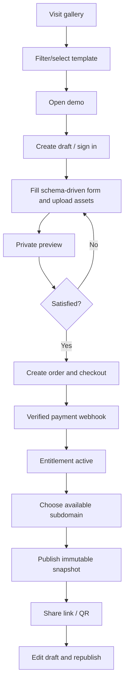

# User Flows and States

## Visitor to publication

## Wedding state machine
`DRAFT → ACTIVE → SUSPENDED → ACTIVE` and `ACTIVE → ARCHIVED`. Publication revision is independent of wedding lifecycle status.

## Order state machine
`PENDING → PAID` or `PENDING → CANCELLED`; refunds are separate business events and require entitlement policy.

## Admin flow
Review source and licensing → audit template → create version/manifest/schema → staging render → visual regression → activate version → monitor errors → retire version only when existing weddings remain supported.

## Failure paths
- Upload rejected: explain type/size/quota; keep draft unchanged.
- Payment delayed: pending page polls authoritative order state; never trust redirect alone.
- Slug collision: offer alternative; database unique constraint remains source of truth.
- Render failure: do not switch active publication; report error and allow retry.
- Domain disabled: show safe not-found state.
